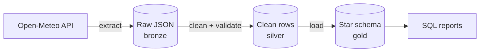
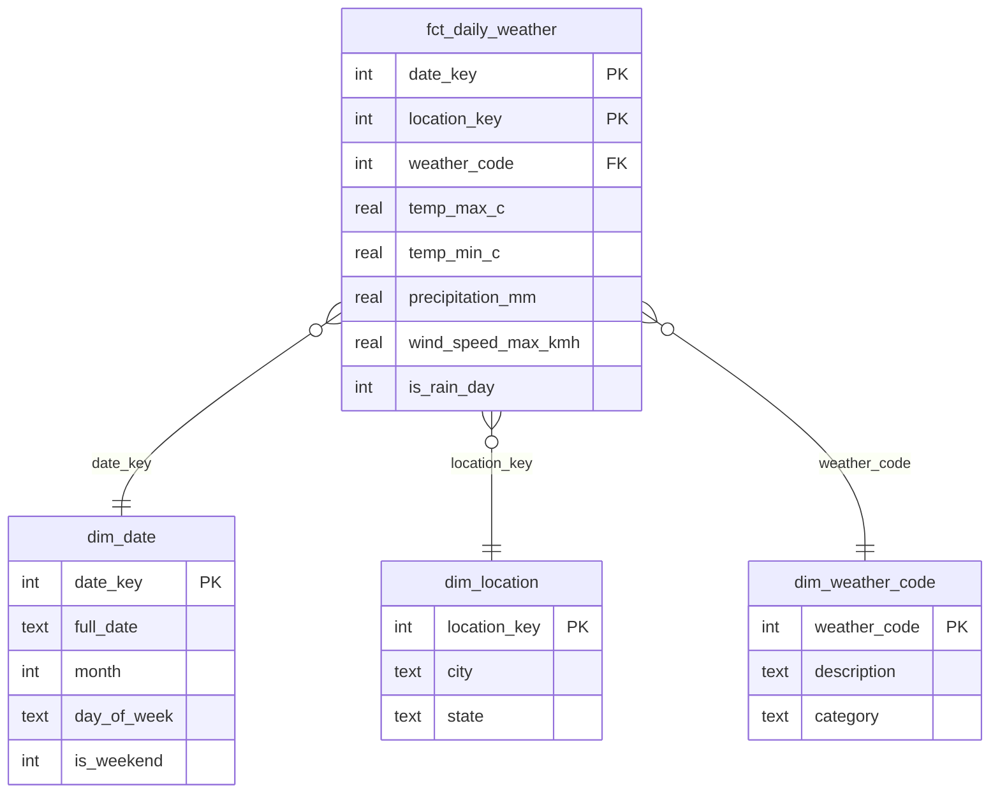

# Weather Pipeline

I wanted my practicing data engineering project to use real data, run end to end, and be safe to
re-run as many times as I liked. This is the result: a small batch pipeline that pulls daily
weather for five Australian capital cities from the free [Open-Meteo](https://open-meteo.com/)
archive API, checks it, and loads it into a star schema I can query with SQL.

For now everything
runs locally on SQLite. Docker, Postgres and S3-style storage are the next step.

## How it works



The data passes through three layers, and each one has a clear job:

- **Raw** (`data/raw/`): the API response exactly as it came back, plus the time I fetched it.
  If I find a bug in my cleaning code, I can rebuild everything from here without calling the
  API again.
- **Clean** (`data/clean/`): one row per city per day, with readable column names and units,
  after passing the data quality checks.
- **Warehouse** (`data/warehouse.db`): a star schema in SQLite, ready for reporting.

## The questions behind it

I framed the project around an imaginary company that runs outdoor events and wants to know:

1. Which city is the hottest each month?
2. How much rain falls in each city per month?
3. How many "nice days" (no rain, 18–28 °C) does each city get?
4. Does it rain more often on weekends than on weekdays?
5. What is the most common type of weather in each state?

Each question has its own query in `sql/reports/`. Here's question 4 on real data
(2025-01-01 to 2026-10-31, <N> rows):

```
<paste the real output of `uv run weather-report` for Q4 here>
```

## The data model

One row in the fact table is **the weather in one city on one day**.



A few details that shaped the queries:

- Temperatures are averaged, never added up. "Total temperature in March" means nothing.
- Rainfall can be summed, so monthly rainfall is just the sum of the days.
- `is_rain_day` is stored as 1 or 0, so `SUM(is_rain_day)` gives the number of rain days.
  I count a day as a rain day when at least 1 mm falls.
- The API returns numeric weather codes (61, 95...). A small lookup file,
  `seeds/weather_codes.csv`, turns them into names like "Slight rain" and groups them into
  seven categories.

## Running it

You'll need [uv](https://docs.astral.sh/uv/).

```bash
git clone https://github.com/<your-username>/weather-pipeline.git
cd weather-pipeline
uv sync

uv run weather-pipeline                                    # the latest available week
uv run weather-pipeline --start 2025-01-01 --end 2026-10-31   # a longer backfill
uv run weather-report                                      # print the five reports
uv run pytest                                              # run the tests
```

The archive API publishes data a few days late, so by default the pipeline loads the week
ending seven days ago. Cities, paths and the data quality threshold live in
`config/settings.yaml`.

## Decisions I made, and why

**Running it twice gives the same result.** Raw and clean files are named after their date
range, so a re-run overwrites them. The fact table deletes and reloads its date range inside a
single transaction. I can re-run any period without creating duplicates.

**The database protects the grain.** The fact table's primary key is `(date_key, location_key)`.
If a bug ever tried to load the same city and day twice, SQLite would refuse it instead of
quietly doubling the numbers.

**Long backfills run one month at a time.** My first version loaded the whole range in one
transaction, so a single bad month would undo all the others. Now each month is extracted,
cleaned and loaded on its own. If month 15 fails, months 1 to 14 are already saved and the log
says where to restart.

**Only retry what might work next time.** Timeouts and server errors (429, 5xx) get retried
after 2 and then 4 seconds. A 400 means my request is wrong, so the pipeline stops straight away
rather than asking again.

**Bad data stops the pipeline.** Rows with missing values, unknown weather codes or impossible
numbers (like a minimum temperature above the maximum) are dropped and logged. If more than 5%
of rows fail, the run stops, because at that point something is wrong at the source.

**Surrogate keys never change.** Dimensions are loaded with `INSERT ... ON CONFLICT DO UPDATE`.
I avoided `INSERT OR REPLACE` because it deletes and re-inserts the row, which gives it a new
key and leaves the fact rows pointing at nothing.

## What I'd improve

- It runs when I run it. There's no scheduler yet; Airflow is on the list.
- SQLite is fine for one person on one laptop, but not for a team. Postgres comes next.
- Five cities and a handful of variables keep it small. Adding more cities only needs a change
  to `config/settings.yaml`.
- The tests use a fake API, which keeps them fast and reliable, but nothing checks the real
  API's response format automatically.

## What I learned

This is mainly served as a refreshing project for me so that I got my hand warm up(it got cold thanks to ChatGPT and Claude).
Its great to practice using python and data engineering fundamental again. Also learning and improving the professional approach of creating a data pipeline

## Project layout

```
config/settings.yaml      cities, API and data quality settings
seeds/weather_codes.csv   WMO weather code lookup
sql/ddl/                  star schema tables
sql/reports/              the five report queries
src/weather_pipeline/
    extract/              API client with retries; saves raw JSON
    transform/            reshapes and validates the data
    load/                 loads the dimensions and the fact table
    utils/                date and seed helpers
    main.py               runs the pipeline
    reports.py            prints the reports
tests/                    pytest suite (<number> tests)
```
